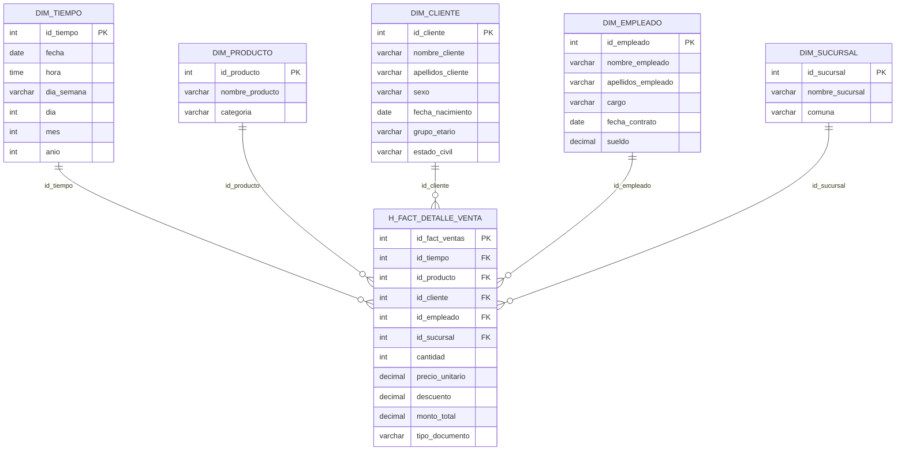

# Certamen 2 - Inteligencia de Negocios

## Caso seleccionado: La Mueblería Albarrán
Empresa del rubro de la mueblería que ha crecido rápidamente y requiere incorporar Inteligencia de Negocios para apoyar la toma de decisiones de su propietario. La base de datos transaccional contiene sucursales, clientes, empleados, ventas y productos.

## Integrantes y sección

| Integrante | Usuario de GitHub |
| --- | --- |
| Cristóbal Carvacho | @CristobalCarvacho115 |
| Tania Contreras | @Netyer |
| Lisbeth Herrera | @Lisherrera |
| Ignacio Parada | @Chumlee197 |

- **Asignatura:** Inteligencia de Negocios
- **Sección:** 300
- **Profesor(a):** Hernan Saavedra

## Descripción del problema
La Mueblería Albarrán registra sus operaciones en una base de datos transaccional pensada para el día a día, no para el análisis. El propietario no cuenta con una vista consolidada que le permita saber qué sucursales, productos, categorías y vendedores generan más ventas, ni cómo cambian las ventas durante el año. Esto dificulta decisiones sobre inventario, surtido, desempeño de la fuerza de ventas y apertura o refuerzo de sucursales.

Los datos analizados corresponden a 365 ventas del año 2017 por un total de $414.022.446 (pesos chilenos), distribuidas en 3 sucursales, 20 productos de 13 categorías, 20 clientes y 6 vendedores.

## Objetivo del proyecto
Objetivo general: diseñar e implementar una solución de Inteligencia de Negocios para la Mueblería Albarrán que apoye la toma de decisiones del propietario.

## KPI definidos

| Categoría | Nombre del KPI | Fórmula / Métrica | Justificación |
| --- | --- | --- | --- |
| Ventas y rendimiento financiero | Ventas Totales ($) | `SUM(monto_total)` | Mide los ingresos brutos totales generados por la mueblería en un periodo determinado. Es el indicador base de crecimiento del negocio. |
| Ventas y rendimiento financiero | Ticket promedio de venta | `SUM(monto_total) / COUNT(DISTINCT id_fact_ventas)` | Evalúa el valor promedio invertido por transacción. Permite identificar la efectividad de estrategias de *upselling* o venta cruzada. |
| Ventas y rendimiento financiero | Porcentaje promedio de descuento | `AVG(descuento) * 100` | Controla el margen de ganancia sacrificado en promociones y valida si los descuentos impulsan el volumen sin comprometer la rentabilidad. |
| Gestión de productos | Volumen de unidades vendidas | `SUM(cantidad)` | Mide la rotación física del inventario. Permite identificar la demanda de muebles según la dimensión `DIM_PRODUCTO`. |
| Gestión de productos | Ingreso por categoría de producto | `SUM(monto_total)` agrupado por `DIM_PRODUCTO.categoria` | Identifica qué líneas de productos (dormitorio, oficina, livings, etc.) generan mayor facturación y cuáles requieren revisión comercial. |
| Gestión de sucursales | Ventas totales por sucursal / comuna | `SUM(monto_total)` agrupado por `DIM_SUCURSAL.nombre_sucursal` o `comuna` | Compara el desempeño operativo entre distintas ubicaciones geográficas para definir decisiones estratégicas de expansión o asignación de recursos. |
| Capital humano | Ventas totales por empleado | `SUM(monto_total)` agrupado por `DIM_EMPLEADO.id_empleado` | Evalúa el desempeño individual del equipo comercial para establecer comisiones, metas de ventas o programas de capacitación. |
| Capital humano | Rendimiento según cargo | `SUM(monto_total)` agrupado por `DIM_EMPLEADO.cargo` | Permite analizar el aporte a los ingresos según el perfil y nivel del trabajador dentro de la estructura de la empresa. |
| Demografía de clientes | Distribución de ingresos por grupo etario y sexo | `SUM(monto_total)` agrupado por `DIM_CLIENTE.grupo_etario` y `DIM_CLIENTE.sexo` | Ayuda a caracterizar el perfil del comprador principal de Mueblería Albarrán, orientando las campañas de marketing directo. |

## Modelo dimensional
Se diseñó un modelo estrella siguiendo los cuatro pasos de Kimball.



### Proceso de negocio
Venta de muebles.

### Granularidad
Una fila por línea de detalle de venta.

### Dimensiones

### DIM_TIEMPO

| Clave | Campo | Tipo |
| --- | --- | --- |
| PK | id_tiempo | int |
| | fecha | date |
| | hora | time |
| | dia_semana | varchar(9) |
| | dia | tinyint |
| | mes | tinyint |
| | anio | smallint |

### DIM_PRODUCTO

| Clave | Campo | Tipo |
| --- | --- | --- |
| PK | id_producto | int |
| | nombre_producto | varchar(50) |
| | categoria | varchar(50) |

### DIM_CLIENTE

| Clave | Campo | Tipo |
| --- | --- | --- |
| PK | id_cliente | int |
| | nombre_cliente | varchar(50) |
| | apellidos_cliente | varchar(50) |
| | sexo | varchar(9) |
| | fecha_nacimiento | date |
| | grupo_etario | varchar(20) |
| | estado_civil | varchar(20) |

### DIM_EMPLEADO

| Clave | Campo | Tipo |
| --- | --- | --- |
| PK | id_empleado | int |
| | nombre_empleado | varchar(50) |
| | apellidos_empleado | varchar(50) |
| | cargo | varchar(50) |
| | fecha_contrato | date |
| | sueldo | int |

### DIM_SUCURSAL

| Clave | Campo | Tipo |
| --- | --- | --- |
| PK | id_sucursal | int |
| | nombre_sucursal | varchar(50) |
| | comuna | varchar(50) |

### Tabla de hechos y medidas

**H_FACT_DETALLE_VENTA**

| Clave | Campo | Tipo |
| --- | --- | --- |
| PK | id_fact_ventas | int |
| FK | id_tiempo | int |
| FK | id_producto | int |
| FK | id_cliente | int |
| FK | id_empleado | int |
| FK | id_sucursal | int |
| | cantidad | tinyint |
| | precio_unitario | int |
| | descuento | float |
| | monto_total | int |
| | tipo_documento | varchar(50) |

## Tecnologías utilizadas

| Tecnología | Uso |
| --- | --- |
| SQL Server 2019 Developer | Base de datos transaccional y dimensional |
| SQL Server Management Studio (SSMS) | Administración y consultas |
| Visual Studio 2019 Community | Entorno de desarrollo |
| SSIS (SQL Server Integration Services) | Proceso ETL |
| Git y GitHub | Control de versiones y gestión de tareas |

## Estructura del repositorio
```
bi-muebleria-albarran-dw/
├── README.md
├── .gitignore
├── docs/
│   ├── modelo-dimensional/   Diagrama y documentación del modelo
│   └── presentacion/         Presentación del proyecto
├── database/
│   ├── scripts/              Scripts SQL del modelo y validaciones
│   └── backup/               Backup (.bak) de la base dimensional
├── etl/
│   └── proyecto-ssis/        Proyecto de Visual Studio con el ETL
├── olap/                     Fase 2
└── powerbi/                  Fase 2
```

## Instrucciones de ejecución/revisión

### 1. Descripción general

El proyecto **Mueblería Albarrán** utiliza **SQL Server Integration Services (SSIS)** para extraer información desde una base de datos transaccional (`Albarran`) y cargarla en un **Data Warehouse** (`Albarran_DW`) diseñado mediante un modelo en estrella.

Este instructivo detalla los pasos necesarios para clonar el repositorio desde GitHub, configurar las conexiones y ejecutar el paquete ETL en cualquier entorno de trabajo local.

---

### 2. Requisitos previos

Antes de comenzar, asegúrate de contar con el siguiente software e insumos instalados y configurados:

* **Git**: Para la clonación y control de versiones del repositorio.
* **SQL Server** (Edición Developer, Express o Standard) con **SQL Server Management Studio (SSMS)**.
* **Visual Studio** (2019 o superior) con la extensión **SQL Server Integration Services Projects** habilitada.
* **Respaldo de Base Transaccional**: Archivo `.bak` de la base de datos de origen `Albarran`.
* **Respaldo del Data Warehouse**: Archivo `.bak` de la estructura del Data Warehouse `Albarran_DW_Estructura.bak`.

---

### 3. Clonación del proyecto

1. Abre tu terminal (Git Bash, Command Prompt o PowerShell).
2. Navega hasta el directorio local donde deseas almacenar el proyecto.
3. Ejecuta el comando de clonación:

```bash
git clone [https://github.com/Netyer/bi-muebleria-albarran-dw.git](https://github.com/Netyer/bi-muebleria-albarran-dw.git)
```

4. Accede a la carpeta clonada del proyecto:
```
cd bi-muebleria-albarran-dw
```
---
### 4. Restauración de las bases de datos

1. Abre SQL Server Management Studio (SSMS) y conéctate a tu instancia local de SQL Server.

2. En el Explorador de objetos, haz clic derecho sobre Bases de datos y selecciona Restaurar base de datos...

3. En la ventana de restauración, selecciona la opción Dispositivo y busca los archivos .bak correspondientes:

   - Albarran: Base de datos transaccional original (contiene clientes, productos, empleados y ventas).

   - Albarran_DW: Base de datos destino (contiene las tablas de dimensiones y la tabla de hechos limpia/vacía).

Nota: Se recomienda restaurar una copia limpia/vacía de Albarran_DW para verificar que el proceso ETL realiza la extracción y carga completa desde cero.

---

### 5. Identificación del servidor SQL
Dentro de SSMS, ejecuta la siguiente consulta en una nueva ventana de consulta:

```
SELECT @@SERVERNAME AS NombreServidor;
```

Guardar el nombre obtenido, ya que será necesario para configurar las conexiones del proyecto.

### 6. Configuración del proyecto en Visual Studio

1. En la carpeta clonada, ubica y abre el archivo de solución del proyecto (.sln) con Visual Studio.

2. En el Explorador de soluciones, ubica y abre el archivo Project.params.

3. Modifica los valores de los parámetros de conexión según tu instancia local:

| Parámetro | Valor |
|---|---|
| `pServidorSQL` | Nombre del servidor SQL del computador |
| `pBaseOrigen` | `Albarran` |
| `pBaseDestino` | `Albarran_DW` |

4. Guarda los cambios (Ctrl + S).

Ventaja de la parametrización: Al estar parametrizadas las conexiones, el proyecto se adapta a cualquier equipo sin necesidad de modificar consultas SQL o componentes dentro de los flujos de datos del ETL.

### 7. Verificación de conexiones

1. Abre el paquete Package.dtsx en el explorador de soluciones.

2. Dirígete al panel inferior Administradores de conexiones.

3. Revisa y prueba las conexiones creadas:

   - LocalHost.Albarran: Conexión hacia la base de datos transaccional.

   - LocalHost.Albarran_DW: Conexión hacia el Data Warehouse.

Haz clic derecho sobre cada conexión y selecciona Probar conexión para garantizar el acceso correcto.

**Importante**: Las conexiones están configuradas con Autenticación de Windows, por lo que tu usuario actual de Windows debe poseer permisos de lectura y escritura en la instancia de SQL Server.

### 8. Ejecución del proceso ETL

1. Abre la pestaña flujo de control dentro de Package.dtsx.

2. Presiona F5 (o haz clic en el botón Iniciar) para ejecutar la solución.

**Flujo de trabajo del paquete**:

1. Limpieza de datos: Se eliminan los registros previos en las tablas del Data Warehouse.

2. Carga de Dimensión Productos (DIM_PRODUCTO).

3. Carga de Dimensión Clientes (DIM_CLIENTE).

4. Carga de Dimensión Sucursales (DIM_SUCURSAL).

5. Carga de Dimensión Tiempo (DIM_TIEMPO).

6. Carga de Dimensión Empleados (DIM_EMPLEADO).

7. Carga de Tabla de Hechos (H_FACT_DETALLE_VENTA).

**Atención**: La primera tarea del flujo elimina la información preexistente en el Data Warehouse. Asegúrate de ejecutarlo únicamente en entornos de desarrollo o pruebas.

### 9. Validación de resultados

Una vez que todas las tareas en el flujo de control se muestren en verde (ejecución exitosa), abre SSMS y ejecuta la siguiente validación:

```
USE Albarran_DW;

SELECT 
    COUNT(*) AS TotalRegistros,
    SUM(monto_total) AS MontoTotal
FROM dbo.H_FACT_DETALLE_VENTA;
```

#### Resultados esperados

**Tabla de hechos (H_FACT_DETALLE_VENTA)**
| Indicador | Resultado esperado |
| --- | ---: |
| Registros de detalle de ventas | 365 |
| Monto total de ventas | $414.022.446 |

**Tablas de dimensiones**

| Dimensión | Cantidad de Registros |
| --- | ---: |
| Productos (DIM_PRODUCTO) | 20 |
| Clientes (DIM_CLIENTE) | 20 |
| Sucursales (DIM_SUCURSAL) | 3 |
| Tiempo (DIM_TIEMPO) | 227 |
| Empleados (DIM_EMPLEADO) | 15 |
 
### 10. Cubo OLAP (fase 2)

El desarrollo del análisis multidimensional está estructurado dentro de la solución `MultidimensionalAlbarran.sln` y el proyecto de Analysis Services `MultidimensionalAlbarran.dwproj`. A partir del análisis de los archivos del proyecto, la arquitectura del cubo se compone de los siguientes elementos técnicos específicos:

* **Conexión y modelo lógico:**
  * `Albarran DW.ds` (data source): archivo que establece la cadena de conexión y las credenciales hacia la base de datos relacional subyacente (data warehouse) en SQL Server.
  * `Albarran DW.dsv` (data source view): vista del origen de datos que define el esquema relacional en SSAS. Este archivo mapea la tabla de hechos con las dimensiones, estableciendo las claves primarias (PK) y foráneas (FK) necesarias para que el cubo entienda las relaciones del modelo.

* **Dimensiones analíticas (.dim):**
  El modelo implementa cinco dimensiones físicas independientes que permiten filtrar, agrupar y desglosar la información del negocio:
  * `DIM CLIENTE.dim`: analiza el comportamiento y la segmentación de los compradores.
  * `DIM EMPLEADO.dim`: permite cruzar los datos para evaluar el rendimiento comercial del personal.
  * `DIM PRODUCTO.dim`: desglosa las ventas según los diferentes muebles y artículos del catálogo.
  * `DIM SUCURSAL.dim`: habilita la comparación del rendimiento de ventas por cada tienda física.
  * `DIM TIEMPO.dim`: dimensión fundamental para establecer jerarquías temporales (año, semestre, mes, día) y analizar la evolución histórica de las ventas.

* **Núcleo multidimensional y optimización:**
  * `Albarran DW.cube`: es el archivo principal del cubo donde confluyen las cinco dimensiones y la tabla de hechos. Define los *measure groups* (grupos de medida) y consolida las métricas cuantitativas requeridas por los KPI del proyecto.
  * `Albarran DW.partitions`: contiene el esquema de particionamiento físico de los datos de la tabla de hechos. El uso de particiones optimiza el procesamiento del cubo y el rendimiento de las consultas, típicamente dividiendo grandes volúmenes de datos históricos en fragmentos más pequeños (por ejemplo, por año o mes).
  * `MultidimensionalAlbarran.database`: archivo de metadatos y configuración que indica cómo debe ser compilada y desplegada la base de datos multidimensional completa dentro del servidor SSAS.

### 11. Dashboard en Power BI

El archivo `panelAlbarran.pbix` contiene el dashboard final diseñado para Mueblería Albarrán. Este panel está construido para consumir la información consolidada en el modelo dimensional y responder directamente a las preguntas estratégicas del negocio. 

Sus componentes y funcionalidades principales son:

* **Visualización interactiva de KPI:**
  La interfaz del reporte está orientada al usuario final y materializa los indicadores de rendimiento definidos en la fase 1 del proyecto:
  * **Análisis de sucursales:** gráficos y matrices que muestran los ingresos totales por sucursal y período, permitiendo comparar la rentabilidad histórica entre las distintas tiendas de la mueblería.
  * **Desempeño del personal:** visualizaciones que evalúan el rendimiento de ventas por empleado, utilizando los datos consolidados de la dimensión empleado.
  * **Rotación de inventario:** análisis del volumen de ventas por producto para identificar rápidamente cuáles son los muebles y artículos más y menos demandados por los clientes.

* **Conexión directa al cubo OLAP:**
  El panel establece una conexión hacia el cubo `Albarran DW.cube` procesado en SSAS. Esto permite que Power BI delegue el procesamiento pesado al servidor multidimensional y herede automáticamente las jerarquías (como año, semestre, mes y día de la dimensión tiempo) y las medidas calculadas previamente.

* **Modelo de datos relacional:**
  A nivel interno, el dashboard refleja el modelo en estrella diseñado en la fase 1, conectando la tabla de hechos central de ventas con las dimensiones de cliente, empleado, producto, sucursal y tiempo para permitir filtros cruzados precisos en toda la página.

### 12. Solución de Problemas Frecuentes

- Error de Conexión / Login Failed:

   - Verifica que el parámetro pServidorSQL coincida exactamente con la salida de SELECT @@SERVERNAME;.

   - Asegúrate de que el servicio de SQL Server esté iniciado en Windows.

- Fallos durante la ejecución en SSIS:

   - Consulta la pestaña Progreso o Resultados de ejecución en Visual Studio para identificar el componente específico que generó el error.

   - Confirma que los permisos del usuario incluyan capacidad de ejecución y modificación de tablas en ambas bases de datos.

## Distribución de responsabilidades y aportes

| Integrante | Responsabilidades | Aportes |
| --- | --- | --- |
| Cristóbal Carvacho | Modelo dimensional, cubo OLAP  | Creación del Data Warehouse. Creación del cubo OLAP. |
| Tania Contreras | Análisis de datos y documentación | Análisis de datos, definición de KPI y documentación del proyecto (README.md) |
| Lisbeth Herrera | ETL, dashboard Power BI | Creación de la base y los orígenes. Diseño del dashboard Power BI. |
| Ignacio Parada | ETL, cubo OLAP | Creación de los destinos, el flujo y la validación de la carga de datos. Creación del cubo OLAP. |
